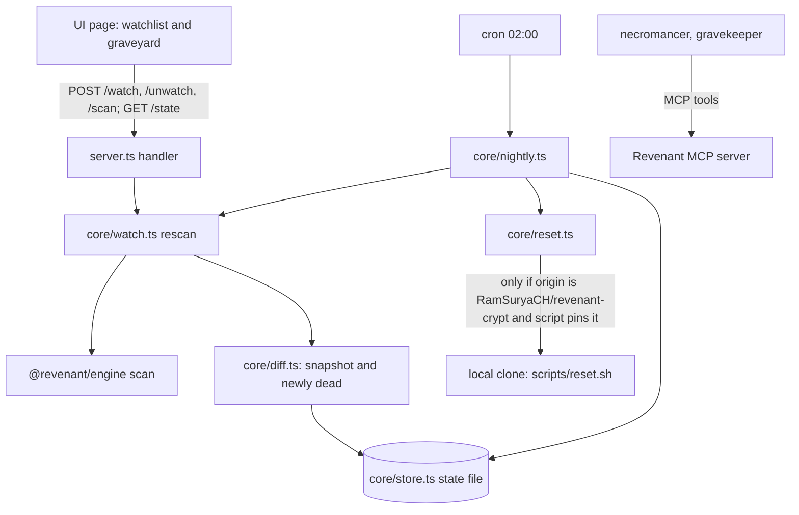

# Design: Graveyard Watch Crew app (as built)

Written after the code, from `apps/crew`. Requirements and tasks came first; this design records what the code does.

The app is a Kiro Crew app (`app.json`): a Node backend (`backend/server.mjs`, bundled from `src/server.ts`), a UI page (`ui/index.mjs`, route `/apps/graveyard-watch`), two agents (`necromancer`, `gravekeeper`), two skills, the Revenant MCP server wired through `bin/revenant-mcp.mjs`, and a cron entry that runs `bin/nightly.mjs` at 02:00. State is one JSON file managed by `core/store.ts` (serialised updates). The backend imports only engine exports.

## Behaviour

- `POST /watch` normalises `owner/name` or a github.com URL, stores it and starts a background scan; `GET /state` returns watchlist, snapshots, running scans and scan errors. Request bodies over 4 KB are refused.
- `nightly` rescans every watched repo, records which packages newly died, then runs the demo reset and returns a readable report. A failed scan or a failed reset sets `ok: false`.
- The reset is a dry run unless `REVENANT_RESET_LIVE=1`, because a live reset closes the demo pull requests. It refuses any directory whose git origin is not the sandbox repo.
- `GITHUB_TOKEN` is read from the gateway environment only; the UI never sees it.

## Not verified

The cron was not observed firing inside a running Crew dashboard, and the page was not captured inside the dashboard.
