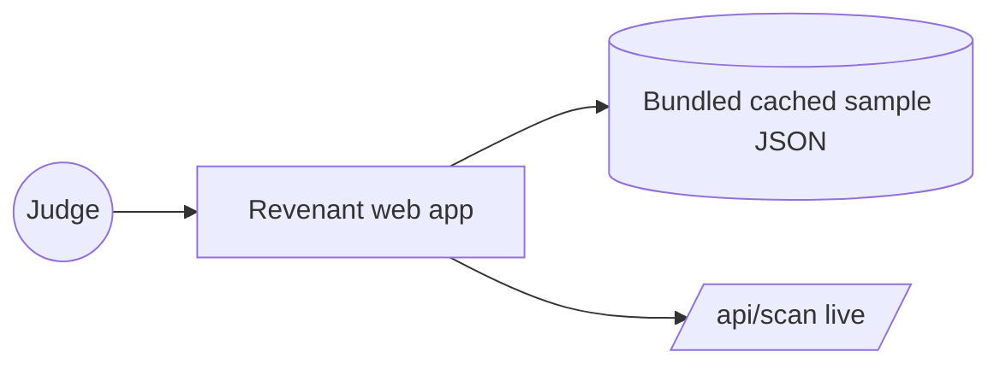

# Design: round 5

## Context (C4 L1)

## Stone art
One hidden `<svg>` sheet (`StoneDefs`, rendered once in the layout) holds gradients and filters. Each stone embeds a small `<svg viewBox="0 0 300 380" preserveAspectRatio="none">` that `<use>`s nothing heavy: body path, grain (feTurbulence from the shared filter), lit edge (stroke gradient, bright top-left), shade edge (bottom-right), carved inset arch drawn twice (dark line plus a 1.5 px light line below it), crack path for dying, ember rim visible on hover/focus. The arch is an ellipse of rx 50% by ry 39.5% of the box, which CSS reproduces exactly (`border-radius: 50% 50% 0 0 / 39.5% 39.5% 0 0`) so the cursor candle overlay clips to the same shape.

Contrast: grain and edge shading darken at most 12% (black overlay); the test computes each gradient stop blended to 12% black and asserts stone text >= 4.5:1.

## Scroll narrative
`Narrative.tsx` is a server component. Data comes from `HERO_STONES`, `HERO_COUNTS` and `request-to-fetch.json` facts via a small `lib/narrative.ts` (pure, tested). A tiny client island `Reveal` adds `data-in` once via IntersectionObserver; without JS or under reduced motion content is visible (CSS default visible, hidden state only under `html[data-js]` and not reduced).

## Share image
`app/opengraph-image.tsx` (next/og ImageResponse, edge-free, static at build) draws ink background, headline in a bundled OFL font file fetched at build is NOT used; it uses the default sans of next/og to avoid a font fetch. Three stones drawn with the same arch geometry as inline SVG; text values read from `HERO_STONES`. `twitter-image` re-exports it.

## Mobile
Filter bar: `position: sticky; bottom: 0` inside the graveyard section under 768 px. Sheet drag: pointer events on `.grab`, translateY follows the finger, release past 96 px or velocity closes via the same close path as Escape.

## Epitaph wording
`displayEpitaph(e)` in `lib/ledger.ts` maps the one known string; all renderers use it; evidence is untouched.

## Well-Architected review
| Pillar | Finding | Sev | Remediation |
|---|---|---|---|
| Ops | Spec, log, tests in PR | info | n/a |
| Security | No new input, no new route taking user data | info | n/a |
| Reliability | Narrative reads bundled data, no network | info | n/a |
| Performance | SVG filter cost on many stones | low | One shared filter, static; Lighthouse measured |
| Cost | Static OG image at build, no runtime cost | info | n/a |
| Sustainability | No new JS libraries | info | n/a |

Rejected: WebGL stones (weight, mobile risk); raster stone textures (licence and LCP).
