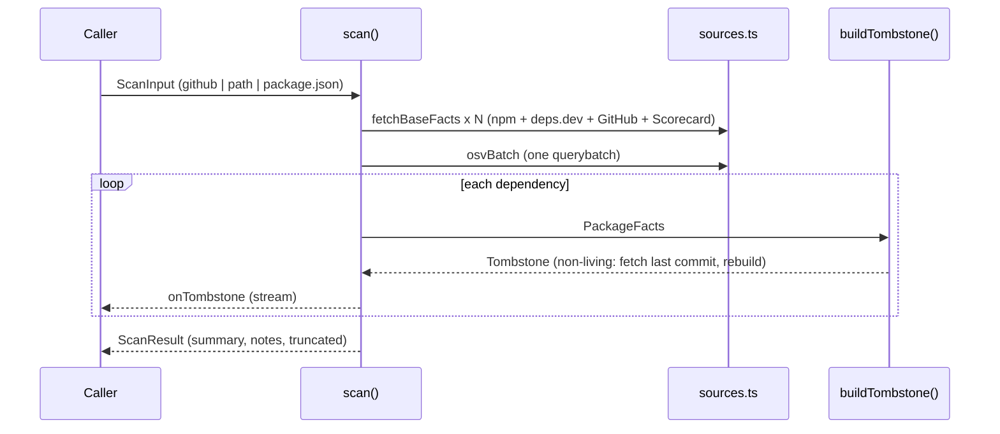

# Design: Revenant engine

## Context

```mermaid
flowchart LR
  subgraph Consumers
    WEB[apps/web]
    CLI[revenant CLI]
    MCP[MCP server - later]
    CREW[Kiro Crew app - later]
  end
  ENG[@revenant/engine]
  WEB --> ENG
  CLI --> ENG
  MCP --> ENG
  CREW --> ENG
  ENG --> NPM[(npm registry)]
  ENG --> DD[(deps.dev)]
  ENG --> OSV[(OSV querybatch)]
  ENG --> SC[(OpenSSF Scorecard)]
  ENG --> GH[(GitHub REST + raw)]
```

## Pipeline



## Modules

| Module | Responsibility | Requirements |
|---|---|---|
| `schema.ts` | Frozen zod contract, `SCHEMA_VERSION` | R1.1 |
| `facts.ts` | `PackageFacts` and `FIELDS`; `lookupField` proves cited values | R3.2, R3.3 |
| `sources.ts` | Network access, per-source failure isolation | R3.1, R3.4 |
| `scoring.ts` | Pure vitality and status | R4.1-R4.3 |
| `tombstone.ts` | Facts to epitaphs, cause of death, successor | R3.2, R6.2 |
| `successors.ts` | Curated table and deprecation-message parser | R6.2 |
| `scan.ts` | Input handling, fan-out caps, streaming | R2.x, R5.1 |
| `cli.ts` | Commands | R6.1 |

## Decisions

- Facts are collected first and rendered second, so the evidence invariant is testable without a network.
- Cause of death is composed deterministically from cited facts. No LLM is involved, so nothing can be invented.
- The curated table is labelled `source: "curated"` in evidence because no listed API publishes successors.

## Error handling

Per-source `safe()` wrapper turns 429/403/timeouts into notes. `ScanError` codes: `not-found`, `rate-limited`, `invalid-manifest`, `unreachable`.

## Testing

Vitest unit tests, fast-check properties (scoring bounds and monotonicity, evidence equality), schema validation of the committed sample.

## Well-Architected review

| Pillar | Finding | Severity |
|---|---|---|
| Security | Server token only via env; input validated (GitHub URL regex, zod) | info |
| Reliability | Per-source isolation, caps, cache fallback in web | low |
| Performance | Bounded concurrency (8/6), one OSV batch | info |
| Cost | Only free public APIs; no LLM in engine | info |
