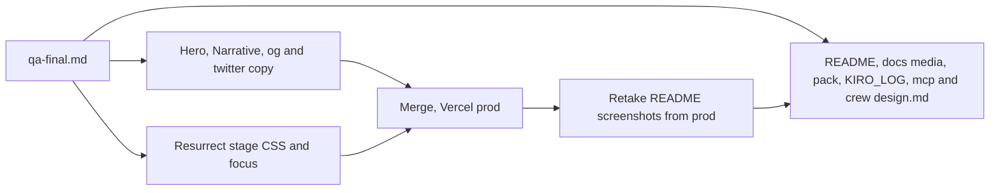

# Design: Final polish

Text and CSS changes only, plus new media and two design docs. No engine change, no new dependency.

## Decisions

- Copy (R1): one sentence everywhere: "One click shows the Kiro spec, the patch, the property tests and the real pull request it became." The Narrative line already says the PR is real only on the sandbox repo; keep that.
- Focus (R3.2): in `ResurrectSequence`, focus the Close button of the stage dialog after mount; the existing close path already restores focus to the opener.
- Overlap (R3.1): inspect the end state in a browser, then give the version and name their own grid row away from the crack layer.
- Terms (R3.3): "differential tests" in the stage card, PR card and narrative; counts come from `crypt-verification.json` (moment 7, request 6, uuid 4).
- Hero wrap (R3.4): keep the three links on one flex row at 390 px by tightening gap and text, or put the third link on a deliberate second row only when needed.
- Band (R3.5): find the spacing between the hero and the next section and cut it.
- Screenshots (R2): taken after deploy with one browser at a time, saved under `docs/` with stable names; old images removed only when `grep` shows no link.
- Design docs (R4.3): written after reading `packages/mcp` and `apps/crew`.

## Testing

Typecheck, lint, all vitest including property tests, build. Existing tests that assert copy are updated with the new copy. Prod check at 1440x900 and 390x844 for the invariants listed in requirements.

## Well-Architected note

No infrastructure change. Risk: low; rollback is reverting the squash commit.
