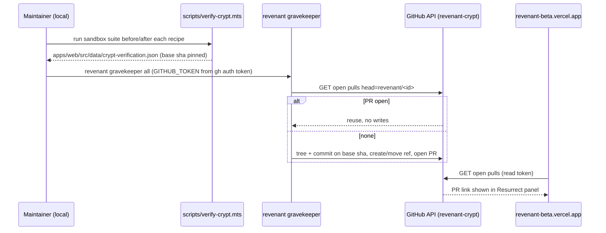

# Design: Gravekeeper pull requests

## Flow

## Components

- `packages/engine/src/gravekeeper.ts`: `openResurrectionPr` (write path, local only), `findResurrectionPr` (read path), `prBody`. Uses the Git Data API, so no git binary or clone is needed. Hard guard `isSandboxRepo` runs before any request.
- `packages/engine/src/cli.ts`: `revenant gravekeeper <recipe|package|all>`.
- `apps/web/src/app/api/gravekeeper/route.ts`: `GET ?recipe=` read-only lookup with the existing read `GITHUB_TOKEN`; no POST handler exists.
- `apps/web/src/components/ResurrectPanel.tsx`: shows the PR link for the sandbox, the patch download for everyone.

## Error handling

- Non-sandbox repo: `GravekeeperError` 403 before any call.
- Branch exists (422 on ref create): force-move `revenant/<id>` only.
- Concurrent PR create (422): re-read open PRs and return the winner.
- Lookup failure in the web app: the panel says the link is unavailable; the patch path is unaffected.

## Security

The write token lives only in the maintainer's shell. The Vercel env keeps the read token used by scans. The PR body is generated from repository content and the committed verification JSON; it contains no secrets.

## Testing

`packages/engine/tests/gravekeeper.test.ts` runs both paths against an in-memory fake GitHub: refusal with zero calls, reuse with zero writes, the committed file set and branch name, and the leftover-branch move.
