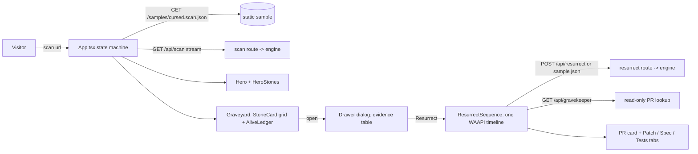
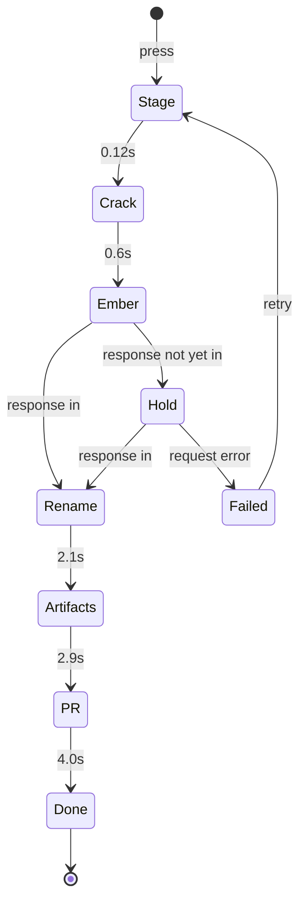

# Design: Graveyard redesign

## Architecture

Context: one visitor, one Next.js app, the engine library behind three API routes. Nothing server-side changes.

Resurrect sequence, as states:

## Components (apps/web/src)

| File | Role |
|---|---|
| `app/globals.css` | Tokens (colour, type scale, spacing, motion), grain, focus ring, reduced-motion rules. |
| `app/layout.tsx` | next/font: Fraunces (opsz), Inter, JetBrains Mono. Preload only what the first view uses. |
| `lib/tokens.ts` | The colour pairs as data, used by CSS comments and by the contrast test. |
| `lib/ledger.ts` | Pure helpers: `clampAtWord`, `summaryLine`, `sourceChips`, `evidenceRows`, `heroPicks`. Unit tested. |
| `lib/contrast.ts` | WCAG relative luminance and ratio. |
| `data/hero-sample.ts` | Three tombstones (request, uuid, moment) copied from the precomputed sample by `scripts/embed-hero.mjs`, so the hero paints with no fetch. A test asserts it equals the sample. |
| `components/Hero.tsx` | Headline, scan form, links, ledger counter, `HeroStones`. |
| `components/Stone.tsx` | One stone card (SVG body, glyph, name, epitaph clamp, chips). |
| `components/Graveyard.tsx` | Header, summary, filter, stone grid, alive ledger, source ledger during streaming. |
| `components/Drawer.tsx` | Native dialog as drawer or sheet, evidence table, sticky action bar. |
| `components/ResurrectSequence.tsx` | WAAPI timeline, data hooks, failure and reduced-motion paths. Dynamically imported on first hover or press. |
| `components/PrCard.tsx` | PR result and the Patch / Spec / Tests viewer (existing logic kept). |

`App.tsx` keeps the scan state machine (idle, loading, streaming, ready) and the fetch logic unchanged; it only composes the new components. `Scene.tsx`, `Plot.tsx` and the lantern art are removed.

## Design tokens

Colour, spacing, type and motion tokens are those of the direction document section 4 and are recorded in `.kiro/steering/design-system.md`. Contrast pairs asserted by test: bone, mist, dim, ember, moon, rot, dying, alive and lantern on ink and on surface; ink on ember; stone text on stone; the `edge` border on surface at 3:1.

## Hierarchy decisions

- Dead and dying: large stone cards, 3 columns desktop, 2 tablet, 1 mobile. Alive: one collapsed row ("8 alive, checked") that expands to a dense ledger of name, version, last publish and an open-circle glyph. This removes label overlap by construction.
- Summary: "3 of 3 direct dependencies are dead or dying" computed from `direct` and `status`; the old percentage is demoted to a caption.
- Epitaph clamp: three lines by CSS plus `clampAtWord` for a 140-character cut so a URL is never split.

## Resurrect timeline

One `Animation` group built with `element.animate` on a fixed set of layers (stone, crack path, ember mask, name, three cards, PR card). A single master `Animation` on a dummy element drives progress; layer animations are created with `fill: both` and their `startTime` aligned, so `finish()` yields the final state and the timeline can be scrubbed in tests. Only `transform`, `opacity`, `clip-path` and `stroke-dashoffset` animate. Ember motes: 2D canvas, 40 desktop, 24 mobile, only during the ember beat, created in the dynamic chunk. The response is requested on press; the timeline runs to the Ember beat, then waits for the promise (R5.3). Failure plays the crack's reverse (R5.4).

Reduced motion: the same five state components render in order, advanced by a Next button or a 400 ms crossfade, each with a text caption.

## Data and honesty

Every number in the sequence comes from `Resurrection` (`stats`, `files`, `patch`, `spec`, `tests`) or the gravekeeper lookup. Patch +/- counts are counted from the patch text. No write token is added to the app; `/api/gravekeeper` stays read-only.

## Performance plan

LCP element is the `h1`. Hero art is inline SVG. No animation library. The sequence chunk is dynamic. Grain is an inline SVG data URI filter at low opacity. Fog drift runs on two layers, pauses when hidden (`visibilitychange`) and under reduced motion. Measured with Lighthouse mobile on the preview and recorded in the PR.

## Well-Architected review

| Pillar | Finding | Severity | Remediation |
|---|---|---|---|
| Operational excellence | UI-only change; rollback is a revert of one squash commit. | info | none |
| Security | No new token, no new route, user strings rendered as text only; links use `rel="noreferrer"`. | low | evidence URLs are only linked when they start with `https://` |
| Reliability | Hero does not depend on the network; sequence handles slow and failed responses. | low | tested by unit tests on the state helpers |
| Performance efficiency | New fonts weights and SVG art add bytes. | med | measured; sequence chunk is lazy |
| Cost optimisation | Static hosting only; no new function calls. | info | none |
| Sustainability | Ambient motion pauses when hidden. | info | none |

## Testing strategy

- Unit (vitest in `apps/web`): contrast of every token pair, `clampAtWord`, `summaryLine`, `evidenceRows` over the sample (every row has source and field), hero data equals the sample, patch line counting.
- Existing engine tests (including `epitaph-evidence`) remain untouched and green.
- Browser checks (not committed as tests): scrollWidth at 360 and 390 after a scan, keyboard path, reduced motion, Lighthouse mobile, axe.
