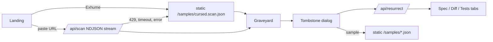

# Design: Graveyard UI

## Components

| Component | Notes | Requirements |
|---|---|---|
| `Landing` | Hero, fog layers (CSS), input, sample button | R1.1, R4.1 |
| `Graveyard` | CSS grid of `Tombstone` / `Tree`, progressive reveal | R1.2, R2.1 |
| `TombstoneDialog` | Native `dialog`, epitaphs with source fields | R2.2, R4.2 |
| `ResurrectPanel` | Tabs: Spec, Diff, Tests; download | R3.1, R3.2 |
| `/api/scan` | Edge-safe Node route, NDJSON stream, caps | R1.2, R1.3, R5.1 |
| `/api/resurrect` | Fetch capped sources, run recipe | R3.1 |

## Data flow and fallback

The client reads NDJSON lines (`tombstone`, `note`, `done`, `error`). On `error` or stream failure it fetches the static sample and renders a banner with the reason.

## Visual language

See `.kiro/steering/design-system.md` and `DESIGN.md`. SVG and CSS only, no WebGL.

## Well-Architected review

| Pillar | Finding | Severity |
|---|---|---|
| Performance | Static sample, no client JS framework beyond React, SVG tombstones | low |
| Security | `GITHUB_TOKEN` server-only; repo URL validated by regex before use | info |
| Reliability | Cached fallback path for every live failure | info |
| Cost | No paid APIs | info |
