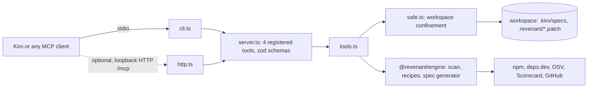

# Design: Revenant MCP server (as built)

Written after the code, from `packages/mcp/src`. The spec's requirements and tasks came first; this design records what the code does.

`@revenant/mcp` exposes four tools over stdio (`cli.ts`) and, optionally, a loopback-only streamable-HTTP endpoint (`http.ts`, `127.0.0.1`, path `/mcp`, stateless, Host header checked against DNS rebinding). `server.ts` registers the tools with zod input schemas and answers every call with one JSON envelope (`ok`, plus data or an error). Failures return `isError` data instead of throwing, so the model can recover. `tools.ts` holds the logic and calls only exports of `@revenant/engine` (`sources.ts` wires the live data sources). `safe.ts` confines every file operation to `REVENANT_WORKSPACE` (or the working directory), resolving symlinks first.

## Tools

| Tool | Reads | Writes |
|---|---|---|
| `scan_dependencies` | repo URL or workspace directory, public APIs | nothing |
| `explain_tombstone` | scan result for one package, with cited fields | nothing |
| `plan_resurrection` | workspace sources | `.kiro/specs/resurrect-<package>/` (requirements, design, tasks) and the patch; refuses to overwrite unless asked |
| `apply_recipe` | workspace sources | returns the diff; with `savePatch`, `.revenant/<name>.patch`. It never edits sources. |

## Errors

`ToolError` codes (`outside-workspace`, `invalid-input`, `not-found`, `no-recipe`, `nothing-to-migrate`, `exists`, `scan-failed`, ...) carry a `retryable` flag and are returned as data.

## Tests

Unit tests cover confinement, each tool and the envelope; a raw-client smoke script talks to the server over stdio.
