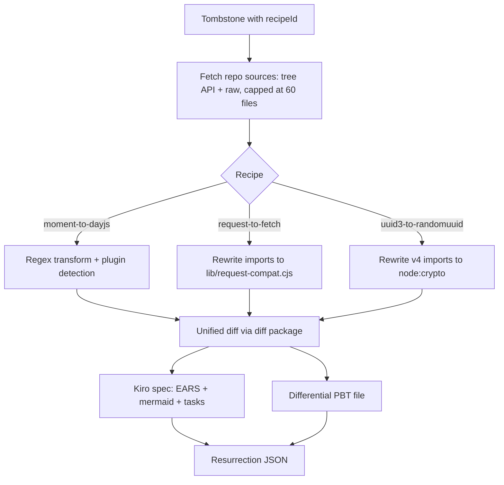

# Design: Resurrection recipes

## Recipe contract

`Recipe { id, package, transform(file), extraFiles(), editPackageJson(), testFile, limits }`. Transforms are pure string functions, so they are testable without a repository.

## Differential testing

Test files live as real, runnable files in `packages/engine/recipes/<id>/differential.test.ts` and run in CI against the real `moment`, `dayjs`, `request` and `uuid@3`. `scripts/embed-recipes.mjs` copies them into `src/recipes/generated.ts` so the same bytes ship to users.

| Recipe | Old vs new compared | Not covered |
|---|---|---|
| moment-to-dayjs | format, add/subtract, startOf/endOf, diff, comparisons, ISO parsing | timezone, locales, relativeTime wording |
| request-to-fetch | status and body for GET qs, JSON/form bodies, headers against a local server | streams, jars, multipart, TLS |
| uuid3-to-randomuuid | v4 format, version and variant bits, uniqueness | randomness quality |

## Honest limits

Mutation semantics (moment mutates, dayjs does not) are flagged with TODOs, never silently rewritten. Patches for different recipes are independent: apply one, then regenerate.

## Well-Architected review

| Pillar | Finding | Severity |
|---|---|---|
| Security | No code is executed server-side; patches are text | info |
| Reliability | Files capped at 60 and 120 KB each | low |
| Cost | Deterministic, no LLM calls | info |
