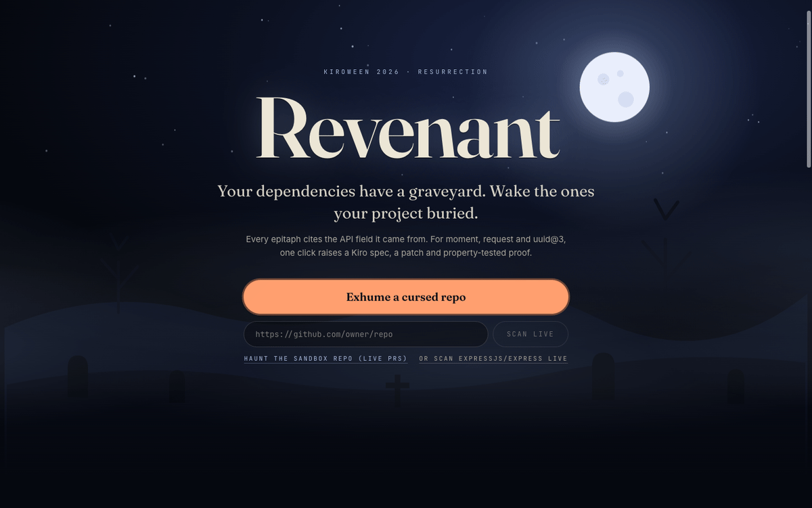
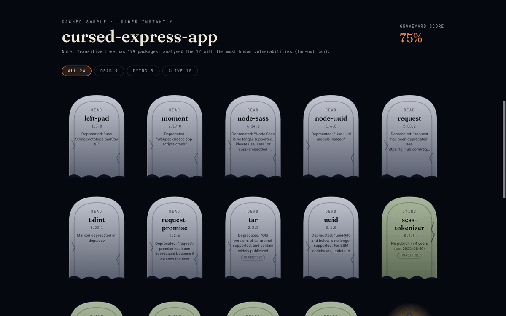
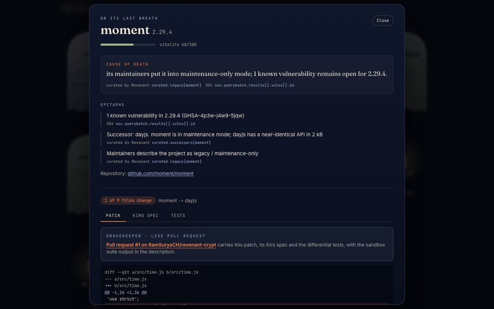

# Revenant

> Resurrect the open-source packages your project buried.

**Live demo: [revenant-beta.vercel.app](https://revenant-beta.vercel.app)** (no login; one click loads a cached cursed repo in under a second)

**Live resurrections** on the sandbox repo [RamSuryaCH/revenant-crypt](https://github.com/RamSuryaCH/revenant-crypt), each with the migration, its Kiro spec, differential tests and the sandbox suite output (16/16 before and after):
[#1 moment to dayjs](https://github.com/RamSuryaCH/revenant-crypt/pull/1) ·
[#2 request to native fetch](https://github.com/RamSuryaCH/revenant-crypt/pull/2) ·
[#3 uuid@3 to crypto.randomUUID](https://github.com/RamSuryaCH/revenant-crypt/pull/3)



Revenant maps a repository's npm dependencies as a graveyard. Dead and dying packages become **tombstones** with epitaphs and a cause of death; healthy ones are **living lanterns**. Every sentence cites the API field it came from, so nothing is invented. For three curated migrations, **Resurrect** produces:

1. a **Kiro spec** (EARS requirements, mermaid design, traceable tasks),
2. a **unified diff** you can download as a `.patch` and `git apply`,
3. **differential property-based tests** (fast-check) that run the old library and the replacement side by side.

Built for Kiroween 2026, category **Resurrection**.


| Graveyard | Resurrection |
|---|---|
|  |  |

## 30-second quickstart

1. Open [revenant-beta.vercel.app](https://revenant-beta.vercel.app) and press **Exhume a cursed repo**.
2. Click the `moment` tombstone, then **Resurrect moment**: read the patch, the Kiro spec and the tests, or download the `.patch`.
3. Press **Haunt the sandbox repo**, open any curated tombstone and follow the link to its live pull request.

## What it does

| Step | Detail |
|---|---|
| Scan | GitHub URL, local path or pasted `package.json`. Direct dependencies plus a capped set of transitive ones (the ones with the most known vulnerabilities). |
| Facts | npm registry (deprecation), deps.dev (publish dates), OSV `querybatch` (vulnerabilities), OpenSSF Scorecard, GitHub REST (archived, last commit). |
| Judge | Pure vitality score 0 to 100. Deprecated or archived means dead. |
| Epitaph | Each epitaph carries `Evidence { source, field, value }`. A property test proves every cited value equals the value in the source facts. |
| Resurrect | Curated recipes: `moment` to `dayjs`, `request` to native fetch, `uuid@3` to `crypto.randomUUID`. |
| Gravekeeper | `revenant gravekeeper <recipe\|all>` opens or reuses the pull request on the sandbox, branch `revenant/<recipe-id>`. The web app only reads and links it. |

Honest limits: exactly three recipes; other packages get "no curated recipe yet". Successors come from a small curated table (labelled `curated`) or from the package's own deprecation message. Differential tests cover pure behaviour (dates, UUID shape, HTTP request/response), not everything a library can do. Mutating `moment` calls and streaming `request` calls are flagged with `TODO(revenant)` instead of being silently rewritten. The AI-written plan for uncurated packages is not built.

## Run it

```bash
pnpm install
pnpm --filter @revenant/engine build
pnpm --filter @revenant/web dev          # http://localhost:3000

# CLI
node packages/engine/dist/cli.js scan https://github.com/expressjs/express
node packages/engine/dist/cli.js scan samples/cursed --out scan.json
node packages/engine/dist/cli.js resurrect scan.json moment --from samples/cursed --patch moment.patch
```

`GITHUB_TOKEN` (server side only) raises GitHub rate limits.

### Gravekeeper (maintainer only)

```bash
packages/engine/node_modules/.bin/tsx scripts/verify-crypt.mts      # sandbox npm test before/after each recipe + differential tests
GITHUB_TOKEN=$(gh auth token) node packages/engine/dist/cli.js gravekeeper all
```

The command refuses every repository except `RamSuryaCH/revenant-crypt`, reuses an open PR instead of opening a duplicate, and pastes the recorded test output into the PR body (GitHub Actions is unavailable on this account because of a billing lock). The deployed app holds only a read token and has no write route, by design: a public button backed by a write token would hand every visitor write access. Reset the sandbox with `scripts/reset.sh` in revenant-crypt. Live scans that hit a rate limit or timeout fall back to the cached sample with a visible note.

## Layout

```
packages/engine   zod schema (frozen), scanner, scoring, recipes, CLI  (@revenant/engine)
apps/web          Next.js App Router graveyard UI, /api/scan (NDJSON stream), /api/resurrect, /api/gravekeeper (read-only PR lookup)
docs              README media and the dead-package study (docs/study/REPORT.md)
samples/cursed    haunted input project; cached output lives in apps/web/public/samples
.kiro             specs, steering, hooks, agents (see KIRO_LOG.md)
```

The engine is a package with clean exports so an MCP server and a Kiro Crew app can consume the same `ScanResult` and `Resurrection` JSON.

## Tests

```bash
pnpm typecheck && pnpm lint && pnpm test && pnpm build
```

Vitest unit tests plus fast-check properties (at least 100 runs): scoring bounds and monotonicity, the evidence-equality invariant, no-op on unrelated code, and differential old-versus-new tests for each recipe against the real `moment`/`dayjs`, `request` and `uuid@3`.

## Use Revenant inside Kiro

Revenant ships an MCP server and a Kiro Crew app. Both use the same engine as the web app, so the evidence behind every cause of death is identical.

### MCP server (Kiro IDE, Kiro CLI, any MCP client)

```bash
pnpm install && pnpm --filter @revenant/engine build && pnpm --filter @revenant/mcp build
```

Paste into `.kiro/settings/mcp.json` (this repo already has it, so Revenant uses itself):

```json
{
  "mcpServers": {
    "revenant": {
      "command": "node",
      "args": ["/absolute/path/to/revenant/packages/mcp/dist/cli.js"],
      "env": { "REVENANT_WORKSPACE": "/absolute/path/to/your/project" },
      "autoApprove": ["scan_dependencies", "explain_tombstone"]
    }
  }
}
```

| Tool | What it does |
|---|---|
| `scan_dependencies` | Repo URL or workspace directory to a graveyard summary (20 worst, truncated) |
| `explain_tombstone` | One package's cause of death with each cited API field |
| `plan_resurrection` | Writes a real Kiro spec to `.kiro/specs/resurrect-<pkg>/` (curated packages only) |
| `apply_recipe` | Returns the patch, its honest limits and the differential test; never edits sources |

Everything is confined to `REVENANT_WORKSPACE` (default: the current directory); paths outside it, including symlink escapes, are refused. Check it standalone with `pnpm --filter @revenant/mcp smoke`. Streamable HTTP is optional: `node packages/mcp/dist/cli.js --http 3939`.

### Kiro Crew app: Graveyard Watch

A dashboard page of watched repositories as tombstones, a "newly dead since last night" list, a `necromancer` agent, a `gravekeeper` agent, two skills, the MCP server above, and a nightly job (02:00) that rescans and resets the demo repo `RamSuryaCH/revenant-crypt` (only that repo, only through its own `scripts/reset.sh`).

```bash
pnpm install && pnpm --filter @revenant/crew build   # bundles backend, nightly job and MCP server into apps/crew
kirocrew app install apps/crew
kirocrew app enable graveyard-watch                   # third-party apps need your trust: approve it in the App Store prompt
```

Needs only Node 20+. Optional: `GITHUB_TOKEN` for GitHub limits, `REVENANT_CRYPT_DIR` for the local clone used by the nightly reset, `REVENANT_RESET_DRY_RUN=1` to preview the reset. The nightly reset closes open `revenant/*` demo pull requests and deletes those branches; set the dry-run variable while judges may be looking at them.

## Built with Kiro

See [KIRO_LOG.md](KIRO_LOG.md) for an honest, dated account, and `.kiro/` for the specs, steering, hooks and custom agents. Design notes: [DESIGN.md](DESIGN.md).

## License

MIT
